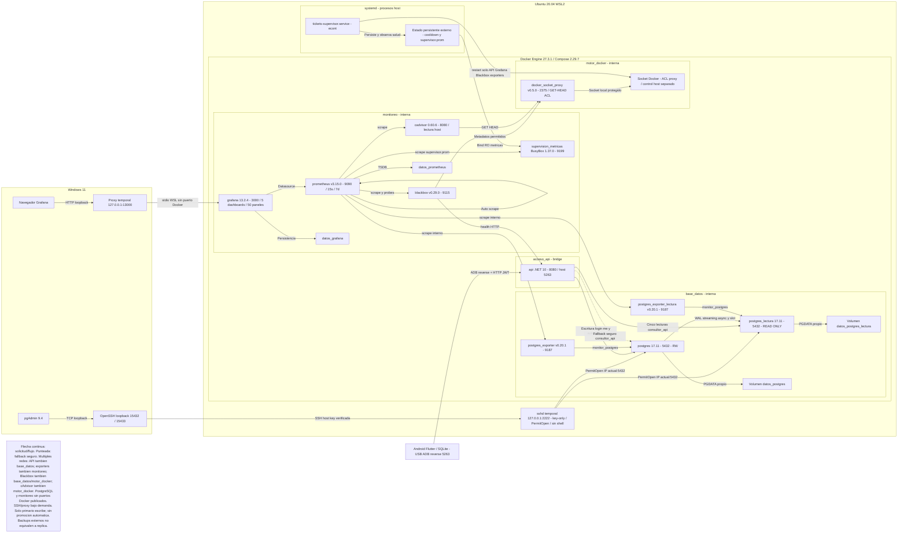

# Arquitectura vigente

Flutter Android conserva SQLite y una cola persistente; durante la práctica usa USB/ADB reverse hacia HTTP 5263. Windows ejecuta pgAdmin 9.4, cliente OpenSSH y proxy Python temporal Grafana. Ubuntu 20.04.6 WSL2 contiene Docker Engine 27.3.1, Compose 2.29.7 y systemd. tickets-supervisor.service corre como econt, fuera de los once contenedores.

API ASP.NET Core .NET 10/Npgsql utiliza imagen local tickets-api:fase12-3, UID1654. PostgreSQL 17.11 primario y standby físico asíncrono tienen almacenamiento independiente; no hay promoción automática. Prometheus/Grafana, cAdvisor, Blackbox, dos exporters SQL, Docker Socket Proxy y supervision_metricas completan la plataforma.

## Redes reales

| Red Compose | Internal | Participantes |
|---|---|---|
| acceso_api | no | api |
| base_datos | sí | api, postgres, postgres_lectura, blackbox, ambos exporters |
| monitoreo | sí | prometheus, grafana, cadvisor, blackbox, ambos exporters, supervision_metricas |
| motor_docker | sí | docker_socket_proxy, cadvisor, blackbox |

El diagrama dibuja cada componente una vez; la tabla expresa sus pertenencias múltiples. Internal limita enrutamiento externo Docker, pero no impide al host WSL acceder a sus bridges ni protege frente a un administrador del host.

| Servicio/acceso | Puerto interno | Publicación/acceso host |
|---|---:|---|
| API | 8080 | 5263 en 0.0.0.0 y :: de WSL, exposición existente |
| PostgreSQL ambos | 5432 | ninguno Docker |
| Grafana | 3000 | ninguno Docker; proxy Windows 127.0.0.1:13000 |
| Prometheus | 9090 | ninguno |
| cAdvisor / Blackbox / exporters | 8080 / 9115 / 9187 | ninguno |
| Socket Proxy / métricas supervisor | 2375 / 9199 | ninguno |
| sshd dedicado | host WSL 2222 | 127.0.0.1:2222 bajo demanda |
| Túneles pgAdmin | destinos privados 5432 | Windows 127.0.0.1:15432 y 15433 |

No se certifica aislamiento LAN de API5263 ni de toda la topología Hyper-V/Windows. Docker27 tiene limitaciones históricas sobre publicaciones localhost; PostgreSQL y monitoreo evitan ese mecanismo. Puertos5432/5433 de otros proyectos no pertenecen a esta arquitectura. SSH temporal no estaba escuchando al auditar esta fase; no se inició.

## Flujos y consistencia

Login, /api/auth/me, rol/actividad, autorización primaria, transacciones y escrituras siguen en postgres. PasswordHasher<Usuario> verifica hashes Identity y el middleware valida JWT. Cinco lecturas replicables usan consultor_api en standby: sucursales, agenda, eventos, solicitudes y técnicos. Cada respuesta usa una conexión/snapshot REPEATABLE READ READ ONLY; conserva alcance y filtros, sin sustituirlos por agenda_tickets.

La API comprueba pg_is_in_recovery y devuelve X-Destino-Lectura. X-Consistencia: inmediata o ?consistencia=inmediata solicita consulta primaria con la cuenta consultora, útil después de escribir. SecretsApi:LecturasEnPrimario=true permite reversión. Standby caído permite un solo fallback seguro a primario; nunca se reintenta una escritura con commit incierto.

Ante fallo transitorio del primario, solo GET protegido con JWT vigente y categorías previamente verificadas puede reutilizar autorización hasta120s desde su última validación primaria. Incluye X-Modo: solo-consultas y X-Autorizacion: temporal-no-confirmada. No confirma una revocación desconocida; existe ventana residual de hasta120s. Login nuevo, /me, escritura y caché ausente/vencida fallan con503/Retry-After5; token inválido/expirado produce401. Reiniciar API elimina caché y falla cerrado.

Timeouts: apertura2s, comando3s, primer intento3s, lectura7s y petición9s; Flutter15s. SQLite conserva pendientes y no los sobrescribe al descargar; guardado local no es confirmación remota.

## Dependencias y almacenamiento

Depends_on service_healthy: api→postgres, grafana→prometheus y cadvisor→docker_socket_proxy. No representa vigilancia continua. Bootstrap standby exige primario accesible, passfile, respaldo ensayado y volumen vacío o standby válido. Volúmenes: datos_postgres, datos_postgres_lectura, datos_prometheus y datos_grafana. Estado/cooldown/presupuesto supervisor reside externo.

Si Engine/WSL se detienen no hay disponibilidad dentro de esa VM. Unless-stopped opera cuando Docker vuelve; no inicia Windows/WSL. Supervisor no repara Engine ni promueve PostgreSQL.

## Diagramas

[draw.io editable](arquitectura.drawio) · [Mermaid importable](arquitectura.mmd). Las versiones proceden del inventario inspeccionado, no de una suposición sobre tags.

